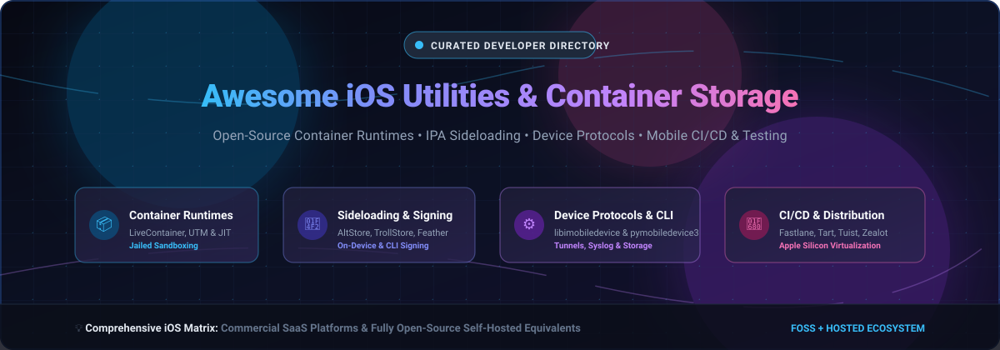

# 📱 Awesome iOS Utilities & Mobile Container Storage

  
  
  
  
  
  

**A battle-tested, curated directory of iOS developer utilities, mobile container storage runtimes, IPA sideloading systems, device protocol bridges, OTA distribution platforms, and Apple Silicon CI/CD infrastructure.**

🌟 *Star this repository if you find it helpful!* 🌟

---

## 📖 Table of Contents

- [📊 Sector Overview & Market Dynamics](#-sector-overview--market-dynamics)
- [☁️ SaaS / Hosted Platforms](#️-saas--hosted-platforms)
- [🔓 Open-Source Equivalents & Utilities](#-open-source-equivalents--utilities)
  - [📦 Mobile Container Storage & Local iOS Utilities](#-mobile-container-storage--local-ios-utilities)
  - [📲 IPA Sideloading, Re-Signing & Package Management](#-ipa-sideloading-re-signing--package-management)
  - [⚙️ Device Management, Protocols & Debugging CLI](#️-device-management-protocols--debugging-cli)
  - [🚀 Self-Hosted Mobile CI/CD, Virtualization & Build Tooling](#-self-hosted-mobile-cicd-virtualization--build-tooling)
  - [📡 Self-Hosted OTA App Distribution & Beta Testing Servers](#-self-hosted-ota-app-distribution--beta-testing-servers)
- [📈 Star History](#-star-history)
- [💖 Support](#-support)
- [🤝 Contributing](#-contributing)
- [📄 License](#-license)

---

## 📊 Sector Overview & Market Dynamics

The global mobile DevOps, continuous integration/delivery (CI/CD), and app distribution market is estimated at approximately **$2.5B–$3.5B**, forming an integral high-growth segment within the broader **$16B–$35B global DevOps market**. The sector is **moderately concentrated at the infrastructure level**—where platform holders (Apple, Google, Microsoft) maintain winner-take-all walled gardens for native compilation, notarization, and store-bound distribution—while remaining **fragmented across specialized niches** such as third-party automated pipelines, independent beta distribution, and alternative sideloading tools.

---

## ☁️ SaaS / Hosted Platforms

Commercial, cloud-hosted iOS build pipelines, proprietary sideloading services, managed beta distribution platforms, and hosted Apple silicon CI/CD.

| Platform | Organization / Backer | Company Size (Valuation / Revenue) | Description | Starting Paid Tier Pricing | Free Tier / Trial Limits |
| :--- | :--- | :--- | :--- | :--- | :--- |
| **[Visual Studio App Center (Legacy / Hosted)](https://appcenter.ms)** | Microsoft | $3.1T+ Market Cap / $245B+ ARR | Microsoft's cloud lifecycle management suite for mobile build automation, crash analytics, and beta distribution (service retired in 2025). | Service retired (Historical paid concurrency began at $40/month per build pipeline) | Service retired (Historically provided 240 free build minutes/month and unlimited distribution testers) |
| **[Xcode Cloud](https://apple.com)** | Apple | $3.5T+ Market Cap / $390B+ ARR | Apple's official continuous integration and delivery service built directly into Xcode for building, testing, and distributing iOS apps. | $49.99/month (100 compute hours/month package) | 25 compute hours/month included free forever with active Apple Developer Program membership ($99/year) |
| **[TestFlight](https://apple.com)** | Apple | $3.5T+ Market Cap / $390B+ ARR | Apple's hosted beta testing platform enabling developers to distribute pre-release iOS builds and collect tester feedback. | $0 additional fee (Fully bundled with $99/year Apple Developer Program membership) | Free forever (Up to 100 internal team testers and up to 10,000 external testers per app; 90-day build expiration) |
| **[Firebase App Distribution](https://google.com)** | Google (Alphabet) | $2.1T+ Market Cap / $350B+ ARR | Google's hosted pre-release app distribution service for rapidly deploying iOS and Android builds to trusted testers. | $0 / month (Fully free no-cost product on both Spark and Blaze plans) | Free forever (Unlimited app distributions, unlimited registered testers, and no bandwidth or build count charges) |
| **[Bitrise](https://bitrise.io)** | Bitrise | ~$240M Valuation / ~$20M ARR ($83M+ VC funded) | Mobile-first cloud CI/CD platform featuring hosted macOS M-series build machines and automated App Store/TestFlight workflows. | $89/month (Starter tier, billed annually; or $99/month billed monthly) | 500 build minutes/month free forever (shared across Linux and macOS M-series VMs, with 1 concurrent build) |
| **[DeployGate](https://deploygate.com)** | DeployGate Inc. | Private / Bootstrapped SMB (<$1M ARR est.) | Managed cloud platform for continuous mobile app distribution, live device log streaming, and team beta testing. | $150/month (Flexible Plan for up to 4 team members) | Free forever (1 project, 2 apps, 2 members, 1 GB storage cap, and 100 instant device testing minutes/month) |
| **[Diawi](https://diawi.com)** | D DOUBLE V SAS | Private / Bootstrapped Micro-SaaS (<$1M ARR est.) | Cloud-based web service for developers to upload IPA/APK files and generate instant over-the-air (OTA) installation links. | €2.99/month (~$3.25/month for Starter plan) | Free forever (Max 50 MB file upload, 10 installations per app, and 3-day link expiration from last install) |
| **[AltStore / AltServer (Hosted Ecosystem & PAL)](https://altstore.io)** | AltStore LLC | Independent Creator / Small Studio (~$500K ARR via Patreon & Grants) | Commercial/open-core alternative app store and sideloading ecosystem offering AltStore PAL in the EU and desktop companion syncing. | $3/month (Patreon beta tier for early access features and test builds) | Free forever (Public releases of AltServer and AltStore PAL free without subscription; standard sideloading bound by Apple free ID 3-app/7-day limit) |
| **[Sideloadly](https://sideloadly.io)** | Sideloadly / iOSGods | Independent Developer Community (<$500K ARR est.) | Proprietary desktop utility for Windows and macOS allowing users to sign and install IPA files onto iOS devices via Apple IDs. | $5/month (Optional Patreon supporter tier for community perks and early beta updates) | Free forever (Software is 100% free; sideloading limits dictated by Apple free accounts: 3 active apps per device and 7-day certificate expiration) |
| **[Cydia Impactor / Hosted Signing Services](http://cydiaimpactor.com)** | SaurikIT, LLC (Jay Freeman) | Independent Maintainer (<$250K ARR est.) | Classic proprietary GUI tool and third-party signing utility for installing unsigned IPA packages on iOS devices. | $0 / Free utility (Requires Apple's $99/year developer account for 1-year certificate validity) | Free forever (Tool is 100% free to download; restricted by Apple free accounts to 3 app IDs per device and 7-day certificate revocation) |

---

## 🔓 Open-Source Equivalents & Utilities

Free and open-source software (FOSS) iOS container utilities, open-source IPA signers, libimobiledevice protocols, self-hosted OTA servers, and macOS/iOS CI runners. Each category is ranked in descending order by community star counts.

### 📦 Mobile Container Storage & Local iOS Utilities

* **[UTM](https://github.com/utmapp/UTM)**  - Full-featured open-source virtual machine host and operating system emulator for iOS and macOS powered by QEMU.
* **[TrollStore](https://github.com/opa334/TrollStore)**  - Open-source jailed iOS app that permanently installs IPA packages with arbitrary entitlements by leveraging CoreTrust exploits.
* **[LiveContainer](https://github.com/LiveContainer/LiveContainer)**  - Groundbreaking iOS container runtime that launches and executes guest iOS apps within a single signed container boundary without exceeding sideload limits.
* **[PongoOS](https://github.com/checkra1n/PongoOS)**  - Pre-boot operating system environment and microkernel for bare-metal Apple hardware research and low-level execution.
* **[ifuse](https://github.com/libimobiledevice/ifuse)**  - FUSE filesystem driver that mounts iOS application sandbox containers, document trees, and media files directly on Linux and macOS.
* **[Crate](https://github.com/oneamendez/crate)**  - Clean open-source iOS container and local storage management utility designed for structured offline file organization.

### 📲 IPA Sideloading, Re-Signing & Package Management

* **[AltStore](https://github.com/altstoreio/AltStore)**  - Pioneering open-source alternative app store for non-jailbroken iOS devices using standard Apple IDs and wireless local signing.
* **[SideStore](https://github.com/SideStore/SideStore)**  - Untethered open-source AltStore fork enabling autonomous on-device IPA signing and certificate refresh over a local WireGuard VPN loop.
* **[Feather](https://github.com/claration/feather)**  - Modern, free, and open-source on-device iOS application manager and IPA installer supporting custom certificate management and community repositories.
* **[zsign](https://github.com/zhlynn/zsign)**  - Blazing-fast cross-platform command-line code-signing utility for iOS `.ipa` packages implemented in C++ without macOS or Xcode dependencies.
* **[Sideloader](https://github.com/Dadoum/Sideloader)**  - Cross-platform IPA sideloading and signing utility written in Nim/C++ for Windows, Linux, and macOS without iTunes dependencies.

### ⚙️ Device Management, Protocols & Debugging CLI

* **[libimobiledevice](https://github.com/libimobiledevice/libimobiledevice)**  - The fundamental cross-platform protocol library and CLI tool suite (`ideviceinstaller`, `idevicesyslog`, `idevicebackup2`) communicating natively with iOS devices over USB and Wi-Fi.
* **[idb](https://github.com/meta/idb)**  - Meta's powerful command-line interface for automating iOS simulators and physical devices, inspecting app containers, and streaming diagnostic telemetry.
* **[ipsw](https://github.com/blacktop/ipsw)**  - Comprehensive iOS/macOS research Swiss Army knife for downloading, parsing, extracting, and analyzing Apple firmware (IPSW/OTA) artifacts.
* **[pymobiledevice3](https://github.com/doronz88/pymobiledevice3)**  - Pure-Python3 implementation for working with Apple protocols, developer disk images (DDI), RemoteXPC tunnels, syslog, and crash logs.
* **[go-ios](https://github.com/danielpaulus/go-ios)**  - Standalone Go implementation providing reliable iOS device communication, app installation, container access, and automated XCUITest execution on Linux and Windows.
* **[Appium XCUITest Driver](https://github.com/appium/appium-xcuitest-driver)**  - Open-source automated UI testing driver for iOS, iPadOS, tvOS, and watchOS backed by Apple's XCTest framework.

### 🚀 Self-Hosted Mobile CI/CD, Virtualization & Build Tooling

* **[Fastlane](https://github.com/fastlane/fastlane)**  - The industry-standard automation toolset for iOS deployment, code signing (`match`), screenshot generation, and App Store Connect synchronization.
* **[SwiftLint](https://github.com/realm/SwiftLint)**  - Essential tool to enforce Swift style and conventions, integrating directly into Xcode builds and CI pipelines.
* **[Swift Package Manager](https://github.com/swiftlang/swift-package-manager)**  - Apple's official open-source package management system for compiling, building, and distributing Swift code across platforms.
* **[XcodeGen](https://github.com/yonaskolb/XcodeGen)**  - Swift command-line tool that generates deterministic Xcode projects from directory structures and YAML specs to eliminate `.xcodeproj` merge conflicts.
* **[SwiftFormat](https://github.com/nicklockwood/SwiftFormat)**  - Comprehensive code formatting CLI tool for reformatting Swift code and maintaining rigorous CI standards.
* **[Tart](https://github.com/openai/tart)**  - High-performance macOS and Linux virtualization engine built on Apple's Virtualization.Framework for ephemeral Apple Silicon CI/CD runners.
* **[Tuist](https://github.com/tuist/tuist)**  - Command-line tool and build infrastructure that scales Xcode project maintenance with modularization, dependency caching, and cloud insights.
* **[Swift Testing](https://github.com/swiftlang/swift-testing)**  - Modern, expressive macro-powered testing library developed by Apple to streamline unit and integration testing across iOS architectures.

### 📡 Self-Hosted OTA App Distribution & Beta Testing Servers

* **[Zealot](https://github.com/tryzealot/zealot)**  - Complete self-hosted Over-The-Air mobile app distribution platform for iOS, Android, and macOS featuring CI webhooks, version history, and UDID capture.
* **[ipa-server](https://github.com/iineva/ipa-server)**  - Lightweight, dockerized self-hosted web server for uploading and distributing `.ipa` and `.apk` binaries wirelessly over HTTPS with QR codes.

---

## 📈 Star History

---

## 💖 Support

Thank you for exploring this curated repository! If you found this resource valuable for your iOS development workflow, container research, or sideloading setup, please consider:

- ⭐ **Starring** the repository to boost visibility for the iOS developer community.
- 🔀 **Forking** the repo and contributing your favorite iOS tools or sideloading utilities.
- 📣 **Sharing** this guide with fellow mobile developers, security researchers, and teams.
- ☕ **Buying a coffee** to sponsor ongoing maintenance and updates:
  
  

---

## 🤝 Contributing

Contributions are welcome! Feel free to open a Pull Request to add more open-source iOS utilities, mobile container storage tools, IPA sideloaders, or iOS DevOps infrastructure.

1. Fork the repository.
2. Add your project under the appropriate category with a concise description and correct repository link.
3. Submit a Pull Request.

---

## 📄 License

This project is licensed under the [MIT License](LICENSE).
